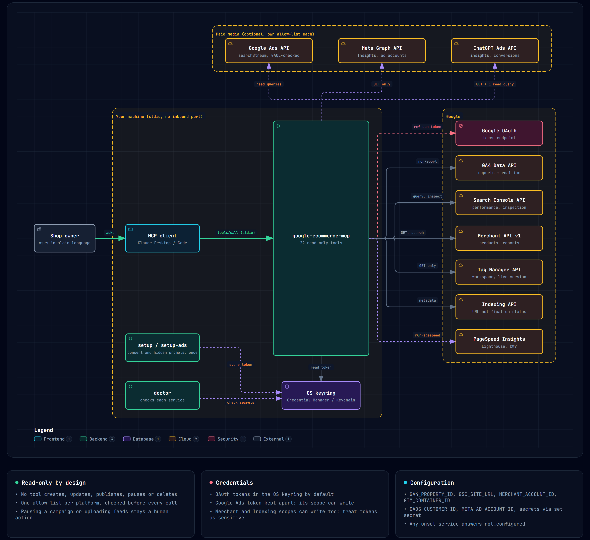
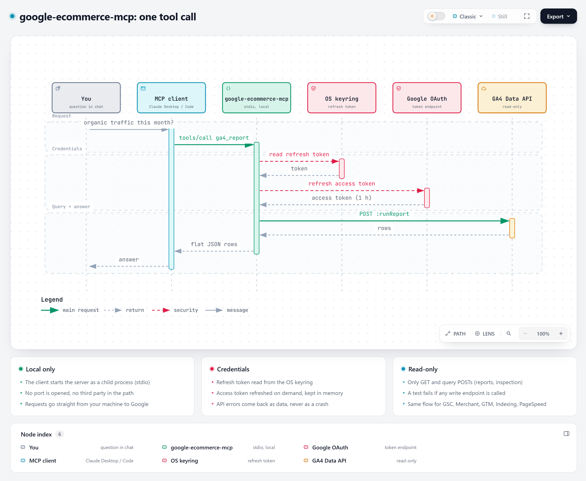
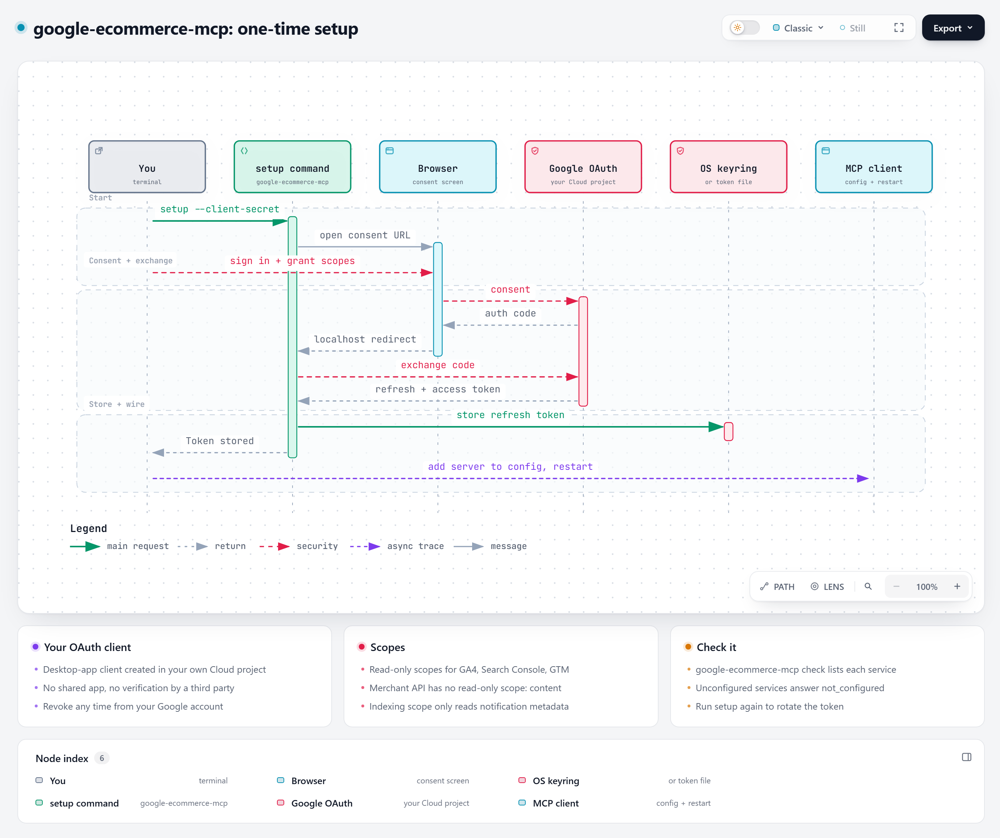

# Architecture

google-ecommerce-mcp is a small, local, read-only bridge between an MCP client (Claude Desktop, Claude Code, or any other MCP host) and six Google APIs, plus, optionally, the Google Ads, Meta Ads and ChatGPT Ads reporting APIs.



Interactive version: [`diagrams/architecture-overview.html`](diagrams/architecture-overview.html) (open it locally in a browser; it is self-contained).

## Components

| Component | File | Role |
|---|---|---|
| Entry point | `src/google_ecommerce_mcp/__main__.py` | `setup`, `check`, or (default) run the MCP server over stdio |
| Configuration | `config.py` | Reads account ids from environment variables, defines the OAuth scopes |
| Credentials | `auth.py` | Stores the refresh token in the OS keyring (or a file), refreshes access tokens in memory |
| Installer | `installer.py` | `install` command: prompts, OAuth setup, Claude Desktop config merge with backup |
| Tools | `server.py` | 13 FastMCP tools for the Google services, one HTTP session, every call wrapped so errors come back as data. It also registers the paid media tools |
| Doctor | `doctor.py` | `doctor` command: per service, set up / secret present / token / status and the exact command to fix it; `--live` makes one minimal read call through the existing tools; never prints a secret, ids masked. Exit code 0, 1 or 2 |
| Setup guide | `setup_guide.py` | The ordered setup steps per service (one bounded action, its command, how to see it worked), shared by `install`, `doctor` and the docs. The Paid media step of `install` lives in `installer.py` |
| Paid media | `ads_*.py`, `google_ads.py`, `meta_ads.py`, `openai_ads.py` | 9 more tools, each platform with its own allow-list and client; see [Paid media modules](#paid-media-modules) |

There is no database, no cache on disk, no background job and no network listener.

## Paid media modules

The paid media connectors are separate modules that `server.py` only imports and registers. They do not share the Google token, the Google allow-list or the Google HTTP session.

| Module | Role |
|---|---|
| `ads_common.py` | The only ads module that sends HTTP requests. Holds `AllowList`, `AdsClient`, secret masking (`redact`), error mapping (`map_error`), a 5-minute cache for discovery calls, the `guard` decorator and the shared calculations (`roas`, `safe_ratio`, `date_range`) |
| `ads_config.py` | `AdsSettings`, read from the environment at each use (never frozen at import), secrets excluded from `repr`; `status()` returns booleans only. Defines the `adwords` scope and its warning, and the keyring entry names |
| `ads_auth.py` | `AdsTokenProvider` (Google Ads OAuth token, separate keyring entry `oauth-token-ads` or `GADS_TOKEN_FILE`), `run_setup_ads`, `set_secret`. Never touches the `oauth-token` entry |
| `google_ads.py` | `gads_accounts`, `gads_performance`, `gads_query`; the GAQL validator and its resource lists |
| `meta_ads.py` | `meta_ad_accounts`, `meta_insights`; Graph API paging by cursor |
| `openai_ads.py` | `openai_ads_account`, `openai_ads_insights`, `openai_ads_conversions`; fixed host |
| `ads_overview.py` | `ads_overview`: calls the `summary()` of each configured connector and puts the results side by side. Sends no request itself |

Each connector module exposes the same small surface: `TOOLS` (title and function pairs), `CLIENT` (its `AdsClient`), `ALLOWED_ENDPOINTS`, `register(mcp)` and `summary(start_date, end_date)` for the overview.

**`AllowList` per platform.** A rule is a method, a URL pattern anchored at both ends with a pinned host, and optionally a body validator. A request is allowed only if a rule matches the scheme, host and path (query strings are not part of the match) and its validator, if any, accepts the body. URLs with whitespace, non-printable characters, `;`, backslashes, userinfo, `..` or encoded slashes are refused outright. Google Ads uses a validator on its `searchStream` body (the GAQL guard); ChatGPT Ads uses one on `conversions/insights`.

**`AdsClient`.** One per platform. `send` checks the allow-list and refuses secrets or `method` parameters in the URL, then calls the session with redirects disabled and the body streamed under a byte ceiling. `call` wraps it and always returns a dict: the parsed JSON, or an error object (`blocked`, `network`, `response_too_large`, or a platform error mapped to `auth_failed`, `missing_scope`, `rate_limited`, `not_available`, `too_many_rows`, `api_error`) with secrets masked. Settings and tokens are read at each call, so a change of environment is honoured without a restart. Tests replace the client's `session` with a fake one, and the connector test suites check that their modules neither import nor call `requests`.

**Tool shape.** Each tool is a module-level function wrapped in `guard` (turns a missing setting into `not_configured` and adds `fetched_at` and `freshness`) and an input-containment wrapper (invalid input and unexpected exceptions become `invalid_*` and `internal_error` results). The annotations declare `readOnlyHint`.

## Client report package

`google-ecommerce-mcp report` runs `report/` (a package, not part of the MCP server). It reads one JSON file and writes one static HTML file. It makes no network call and imports no platform client.

| Module | Role |
|---|---|
| `contract.py` | The input contract, `sanitize` (personal-data keys removed, e-mails masked, wrong blocks reported in `errors`) and the accessors sections use (`view`, `periodic`, `totals`, `rows`) |
| `period.py` | Reads `periods`, labels, Search Console lag |
| `compare.py` | Changes between periods: polarity per metric, noise rule (about 2 standard deviations), small-volume rule, Core Web Vitals zones |
| `confidence.py` | High / medium / low with reasons |
| `summary.py` | The three key messages and the decisions, built only from supplied figures |
| `svg.py` | Inline charts: sparkline, columns, lines, bars, thresholds (bars from zero, gaps for missing values) |
| `style.py` | The inline stylesheet and print CSS |
| `brand.py` | The client's name, accent and logo, validated |
| `i18n.py` | French and English texts and number/date formats |
| `render.py` | `ReportContext`, escaping, the notes mini-markdown, assembly, `write_report` |
| `sections/<id>.py` | One module per section: `kpi`, `funnel`, `channels`, `products`, `seo`, `merchant`, `ads`, `cwv`, `data_quality`, `events` |

Parts are ported from OpenGSC (MIT); see `THIRD_PARTY_NOTICES.md`. Guide and contract: [REPORTING.md](REPORTING.md).

## Transport

The MCP client launches the server as a child process and talks to it over **stdio** (JSON-RPC on stdin/stdout). Nothing listens on a port, so nothing on your network can reach the server. The process lives as long as the client keeps it open.

## A tool call, step by step



1. You ask a question in the chat. The model picks a tool, for example `ga4_report`, and the client sends `tools/call`.
2. On the first call only, the server reads the refresh token from the OS keyring.
3. If the in-memory access token is missing or expired, `google-auth` refreshes it against Google's token endpoint. Access tokens live about one hour and are never written to disk.
4. The server calls the Google API with `Authorization: Bearer ...`.
5. The raw response is flattened into compact JSON (for example GA4 rows become `{"dimension": value, "metric": number}` objects). Report tools add what the model needs to read the numbers correctly: totals over every row, the unit and definition of each metric, and the date range resolved in the data's timezone with `data_complete`. The result goes back to the client.

## One-time setup



`google-ecommerce-mcp setup --client-secret client_secret.json` runs Google's installed-app OAuth flow: a temporary localhost redirect catches the authorization code, the code is exchanged for a refresh token, and the token is stored. The setup command is the only code path that writes the token.

## Design choices

**Read-only by construction.** Every request goes through `_send` in `server.py`, which checks it against `ALLOWED_ENDPOINTS` (method and URL pattern) and refuses anything else before it leaves the process. The list holds only `GET`s and the `POST`s Google uses for queries (`:runReport`, `:runRealtimeReport`, `searchAnalytics/query`, `index:inspect`, `reports:search`). `tests/test_server.py::test_every_request_is_on_the_read_only_allow_list` calls every tool and fails CI on any refused attempt; `test_allow_list_has_no_write_endpoint` guards the list itself.

**Read-only per platform.** The paid media connectors repeat the same idea with one allow-list per platform instead of one global list, because the three APIs share nothing: different hosts, auth schemes and error formats. A read-only token cannot be obtained for Google Ads (the `adwords` scope can write), so the allow-list and the GAQL validator are the guarantee there, and the token is stored apart. Details: [SECURITY.md](SECURITY.md#paid-media-connectors-threat-model).

**Errors are results, not exceptions.** A missing variable returns `{"error": "not_configured", ...}`, an HTTP error returns `{"error": <status>, "detail": ...}`, a network failure returns `{"error": "network", ...}`. The model can read and explain the problem instead of seeing a crashed tool.

**Configuration per service.** Every environment variable is optional. Configure only what you use; the other tools answer `not_configured`.

**Plain HTTP instead of Google client libraries.** The REST endpoints are called with `requests`. That keeps the install small (no `google-api-python-client` discovery documents) and makes each call visible in the source.

**Result caps.** Row-returning tools cap `limit` at 1,000 to keep answers within a model's context window. Merchant product scanning is paginated (250 per page, `max_pages` bound).

## Diagram sources

The diagrams are generated with Archify (MIT-licensed diagram renderer) from the JSON specifications next to them in [`docs/diagrams/`](diagrams/). Each one passed Archify's validate, deliver, check and browser-check gates at showcase quality. To change a diagram, edit the JSON and run:

```bash
archify finalize architecture docs/diagrams/architecture-overview.json docs/diagrams/architecture-overview.html --quality showcase
archify finalize sequence docs/diagrams/sequence-tool-call.json docs/diagrams/sequence-tool-call.html --quality showcase
archify finalize sequence docs/diagrams/sequence-setup.json docs/diagrams/sequence-setup.html --quality showcase
```
